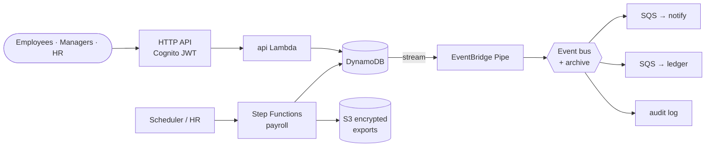

# Serverless, Event-Driven Timesheet & Payroll on AWS

[](https://github.com/Monkmode-tech/serverless-event-driven-timesheet/actions/workflows/ci.yml)


**Roles this project supports:** Cloud Engineer · Cloud Solutions Architect · Cloud DevOps Engineer · Cloud Security Engineer

## In plain terms (2-minute read)

**The problem.** Every company has to track employees' hours, get them approved by managers, and
turn them into correct paychecks. It's sensitive (salaries are confidential), it has legal rules
(overtime must be paid at 1.5× after 40 hours a week), and the load is lumpy: everyone submits on
Friday, then nothing happens all weekend.

**What I built.** A complete timesheet and payroll system on AWS, written entirely as code:

- **Employees** record their hours for the week. **Managers** approve or send them back, but only
  for their own team. **HR** sets pay rates and runs payroll. Each person sees only what their job requires.
- **Payroll runs itself** every Monday. It calculates pay, including overtime, to the exact cent,
  and produces an encrypted spreadsheet for HR. It can safely be re-run and never pays anyone twice.
- **Every action triggers the next automatically.** An approval notifies the employee and updates
  project-hour reports. If one of those follow-up tasks fails, it is retried and set aside for review.
  The approval itself is never lost.
- **It costs about $3 a month** when idle and roughly **$2.40 per million requests**, because it
  uses pay-per-use services instead of servers.

**Proof, not promises.** An end-to-end script plays all three roles. The employee submits 45
hours, the manager approves, payroll runs, and the script checks the paycheck: 40 regular hours +
5 overtime hours = exactly $1,900.00. Two "fire drill" scripts break things on purpose: one shows
a bad message is caught without blocking others, and one replays every event to show nothing is
double-counted. 40 automated tests run on every change.

**Why it matters to a business**

| Business need | How this project delivers it |
|---|---|
| Pay people correctly, by the law | FLSA weekly overtime, integer-cent math, tested to the cent |
| Keep salaries confidential | Pay rates visible to HR only; never in logs, events, notifications or workflow history |
| Managers approve only their own team | Checked on every request, at the data level |
| Never lose an approval or double-count hours | Events come straight from committed database writes; every consumer is idempotent |
| Know immediately when something breaks | Alarms on dead-letter queues, latency (p95 < 300 ms), errors and failed payroll runs |
| Keep payroll records as required | Encrypted exports, archived after 90 days, kept 7 years |
| Low cost that tracks usage | Fully serverless: ≈ $3/month idle; cost per 1,000 requests shown live on the dashboard |

**What this shows about how I work.** I take a design from my coursework and build it for real,
including the unglamorous parts: failure handling, privacy, audit trails, runbooks, and tests that
prove the money math.

## Technical summary

- **Identity & API:** Cognito user pool (admin-created users, groups `employees` / `managers` / `hr`,
  optional TOTP MFA) → API Gateway **HTTP API with a JWT authorizer** on every route → one Python 3.12
  arm64 Lambda that enforces **group-based route authorization and data-level checks** (a manager's
  `managerId`; no self-approval).
- **Data:** DynamoDB **single-table design** with two GSIs (manager queue; approved-by-week),
  **optimistic concurrency** via `version` conditions, lifecycle state machine
  `SUBMITTED → APPROVED | REJECTED → PAID`, PITR, and a KMS CMK.
- **Events:** **transactional outbox**: DynamoDB Stream → **EventBridge Pipe** (filter + input
  transformer) → custom bus with a 90-day **archive** → rules → **one SQS queue + DLQ per consumer** →
  Lambdas with **partial batch responses**. The ledger consumer is **exactly-once** via a DynamoDB
  transaction (idempotency marker + `ADD`). There is also an audit log of every event.
- **Payroll:** **Step Functions Standard**: Collect → conditional **lock** → inline Map (calculate)
  → encrypted CSV export → Map with **direct DynamoDB integration** (mark PAID, idempotent) → close
  → `PayrollCompleted` event, with catch → mark FAILED → `PayrollFailed`. **EventBridge Scheduler**
  runs it weekly (timezone-aware). The state carries IDs only; logs are ERROR level without execution data.
- **Observability:** EMF business metrics (submissions, approval latency, gross payroll), X-Ray,
  15 alarms, and a dashboard with a **metric-math cost-per-1k-requests** widget.
- **Quality gates:** 40 unit tests against in-memory fakes that evaluate real DynamoDB condition and
  key expressions; ruff, bandit, terraform fmt/validate, tflint, checkov, shellcheck. CI uses no AWS credentials.

## Architecture



Details: [architecture](docs/architecture.md) · [security & privacy](docs/security.md) · [runbook](docs/runbook.md) · [cost](docs/cost.md) · [ADRs](docs/adr)

## Results

> From a live deployment; reports in [`docs/evidence`](docs/evidence).

| Check | Target | Result |
|---|---|---|
| End-to-end flow (submit → approve → ledger → payroll → CSV) | All pass | _pending first deployment_ |
| Payroll correctness: 45 h at $40/h | $1,900.00 | _pending_ |
| API p95 latency | < 300 ms | _pending_ |
| Event latency (approval → ledger updated) | < 5 s | _pending_ |
| Replay of all events changes totals | Never | _pending_ |
| Cost per 1,000 requests (dashboard) | < $0.01 | _pending (estimate $0.0024)_ |
| Unit tests | Pass | 40 passing in CI |

## Quick start

```bash
aws sso login && export AWS_PROFILE=<profile>
cd infra/environments/dev
cp backend.hcl.example backend.hcl && cp terraform.tfvars.example terraform.tfvars
terraform init -backend-config=backend.hcl && terraform apply
cd ../../.. && make seed PREFIX=yourname DOMAIN=gmail.com
make e2e            # full business flow, writes an evidence report
make test           # unit tests, no AWS needed
```

## Where to look

| Skill | Evidence |
|---|---|
| Event-driven architecture (outbox, routing, DLQs, replay) | [`infra/modules/events`](infra/modules/events/main.tf), [ADR 0002](docs/adr/0002-transactional-outbox-with-pipes.md) |
| Idempotent, exactly-once processing | [`src/timesheet/events.py`](src/timesheet/events.py), [`tests/test_events.py`](tests/test_events.py) |
| Workflow orchestration with error handling | [`payroll.asl.json`](infra/modules/payroll/payroll.asl.json), [ADR 0003](docs/adr/0003-step-functions-standard-for-payroll.md) |
| Authentication and authorization (RBAC + data-level) | [`infra/modules/identity`](infra/modules/identity/main.tf), [`src/timesheet/api.py`](src/timesheet/api.py), [docs/security.md](docs/security.md) |
| Protecting PII and compensation data | [docs/security.md](docs/security.md) |
| NoSQL data modeling | [ADR 0004](docs/adr/0004-dynamodb-single-table.md), [`infra/modules/data`](infra/modules/data/main.tf) |
| Business rules as tested code (FLSA overtime, cents) | [`src/timesheet/domain.py`](src/timesheet/domain.py), [`tests/test_domain.py`](tests/test_domain.py) |
| Observability and cost per request | [`infra/modules/observability`](infra/modules/observability/main.tf), [docs/cost.md](docs/cost.md) |
| Operations (DLQ handling, payroll recovery, replay) | [docs/runbook.md](docs/runbook.md), [`scripts/`](scripts) |

## Certification alignment

| Exam | Areas exercised |
|---|---|
| AWS Developer – Associate | Lambda, API Gateway, DynamoDB modeling and conditional writes, SQS, EventBridge, Step Functions, Cognito |
| AWS Solutions Architect – Associate | Decoupled serverless architecture, cost-optimized design, S3 lifecycle |
| AWS Security – Specialty | Least privilege, KMS, data protection and classification, authentication |
| HashiCorp Terraform Associate | Reusable modules (one function module, used six times), `templatefile`, `for_each` |

## Glossary (for non-technical readers)

| Term | Meaning |
|---|---|
| Serverless | Cloud services that run code on demand; no servers to manage, and you pay per use |
| Event-driven | Parts of the system react to things that happened ("timesheet approved") instead of calling each other directly |
| Queue / dead-letter queue (DLQ) | A waiting line for work / a holding area for work that keeps failing, for a person to review |
| Idempotent | Doing the same thing twice has the same effect as doing it once, so nothing is double-counted |
| Workflow (Step Functions) | A step-by-step process run by AWS, with retries and a visible history |
| RBAC | Role-based access control: what you can do depends on your role (employee, manager, HR) |
| PII | Personally identifiable information: data about a specific person |
| p95 latency | 95% of requests are answered faster than this |
| FLSA | The U.S. Fair Labor Standards Act, which sets overtime rules |

## Background

Built by **Caleb Tetteh** (M.S. Cloud Computing Systems, UMGC; B.S. Computer Science, Georgia Tech).
It implements the Employee Timesheet Management System I designed in CLCS 605 *Introduction to
Cloud Computing* (Unit 5: serverless architecture, S3 Standard/Glacier tiers, CloudWatch KPIs).
It applies the event-driven integration patterns from CLCS 625 *Applications of Cloud Computing*
(Unit 5: idempotent consumers, retries with backoff, dead-letter queues, measurable KPIs).
