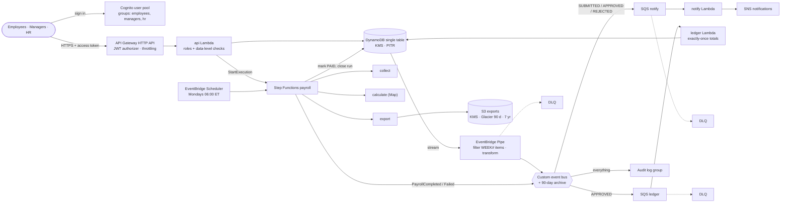
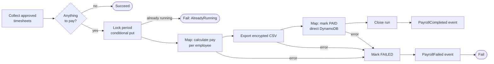

# Architecture

## Request path (synchronous)

1. A user signs in to Cognito and gets a 60-minute access token. There is no self sign-up; HR or
   IT creates accounts.
2. API Gateway's **JWT authorizer** rejects requests without a valid token *before* any code runs.
3. The api Lambda checks the **route's allowed groups** (an employee can't call `/hr/*`), then the
   **data**: a manager may decide only on timesheets whose `managerId` is theirs. A request for
   another team's timesheet gets the same 404 as a missing one, so managers can't probe other teams.
4. Writes use **conditional expressions** for optimistic concurrency (a `version` attribute). Two
   managers clicking at once can't overwrite each other, and an approved week can't be edited.

## Event path (asynchronous)

The API never publishes events itself. That avoids the *dual-write problem*, where the database
write succeeds but the publish fails, or the other way round. Instead:

1. Every committed write appears on the **DynamoDB Stream**.
2. An **EventBridge Pipe** filters it (only `WEEK#` items, so profiles with pay rates never become
   events) and reshapes it into a small `TimesheetStatusChanged` event: IDs, status, version.
3. **Rules** on a custom bus route events to one **SQS queue per consumer**. Queues buffer bursts,
   such as Friday-afternoon submissions, and keep one slow consumer from affecting another.
4. Consumers use **partial batch responses**: one bad message is retried alone. After 5 attempts it
   moves to the queue's **DLQ**, and an alarm fires.
5. Every event also lands in an **audit log** and a 90-day **archive** that can be replayed.

Delivery is at-least-once at every hop, so consumers are **idempotent** on
`(employeeId, weekStart, version)`. The ledger consumer writes its "already processed" marker
and its hour increments in **one DynamoDB transaction**: either both happen or neither does.
`scripts/replay-drill.sh` proves this by replaying an hour of events and confirming the totals don't move.

## Payroll workflow

- **Overtime is per workweek** (FLSA): hours over 40 in a week are paid at 1.5×, and weeks are not
  pooled across the period. Money is integer cents and hours are integer quarter-hours, so there
  is no floating-point drift.
- **No pay data in workflow state.** The state machine passes IDs and totals only. Names and rates
  stay in DynamoDB and the encrypted CSV. Step Functions logs are ERROR level without execution data.
- **Re-runnable.** Marking PAID is conditional (`APPROVED`, or `PAID` by *this* run), so a retried
  step is a no-op. A later run for the same period pays only weeks approved since: a supplemental run.
- **Exactly one run at a time per period**, enforced by the lock item. A run started from the API is
  also named `payroll-<period>-<weeks>w`, and Step Functions refuses duplicate names.

## From the coursework design to this build

| CLCS 605 / 625 design element | Built here as |
|---|---|
| Serverless: API Gateway, Lambda, DynamoDB, S3, CloudWatch | Same services, plus Cognito, EventBridge, SQS, Step Functions |
| Employees, managers, HR, board directors | Cognito groups with route- and data-level authorization (directors: future read-only group) |
| S3 Standard → Glacier tiers | Lifecycle: Glacier after 90 days, deleted after 7 years |
| Event-driven integration, retries, DLQs, idempotent consumers (625) | Outbox via Pipe, per-consumer queues + DLQs, transactional idempotency |
| KPIs: p95 < 300 ms, event success ≥ 99.5%, DLQ backlog capped | Alarms and dashboard widgets for each |
| CI/CD with GitHub Actions; SAM/CloudFormation | GitHub Actions with Terraform (see ADR 0001) |
| Blue/green releases | Roadmap: Lambda aliases with weighted routing (below) |

## Roadmap

- **Canary releases:** publish Lambda versions behind a `live` alias and shift 10% → 100% with
  CodeDeploy, rolling back on the p95 or 5xx alarms.
- **Per-user email:** replace the shared SNS topic with SES templated emails to the recipient
  carried in the message attribute.
- **Board-director role:** read-only aggregate reports (project hours, payroll totals), never individual pay.
- **WAF:** HTTP APIs don't support AWS WAF. Front the API with CloudFront + WAF, or move to a REST API,
  when it is internet-facing for real.
- **Larger payrolls:** switch the Map states to *distributed* mode reading an S3 manifest, past
  roughly 2,000 employees (the 256 KB state payload limit).
